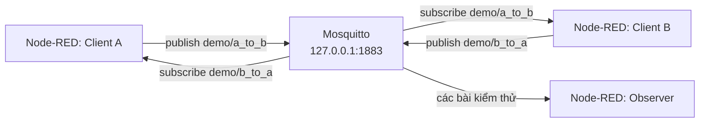

# Hướng dẫn gửi nhận tin nhắn MQTT bằng Node-RED trên Windows

## 1. Mục tiêu

Sau khi hoàn thành, người học có thể:

- Giải thích vai trò của MQTT client, broker, topic và payload.
- Kết nối Node-RED đến Mosquitto bằng MQTT 3.1.1.
- Dựng hai bên A và B gửi nhận tin nhắn hai chiều.
- Kiểm tra topic matching, phân phối một-nhiều, wildcard, retained message và QoS.

## 2. Kiến trúc



Mosquitto là broker. Node-RED tạo ba MQTT client logic trong cùng một runtime. Hai tab của Node-RED chỉ dùng để sắp xếp flow; chúng không phải hai ứng dụng độc lập.

## 3. Phần mềm cần có

| Phần mềm | Yêu cầu | Nguồn chính thức |
|---|---|---|
| Windows | Windows 10 hoặc 11 | Có sẵn trên máy thực hành |
| Node.js | Bản LTS 64-bit | <https://nodejs.org/en/download> |
| Node-RED | Cài bằng npm | <https://nodered.org/docs/getting-started/windows> |
| Mosquitto | Bộ cài Windows 64-bit | <https://mosquitto.org/download/> |

Mô hình chỉ lắng nghe trên loopback. Không mở cổng `1883` ra Internet và không dùng dữ liệu nhạy cảm.

## 4. Cài Node.js và Node-RED

1. Tải và chạy bộ cài Node.js LTS 64-bit từ trang chính thức.
2. Giữ các lựa chọn mặc định của bộ cài.
3. Đóng PowerShell cũ và mở cửa sổ PowerShell mới.
4. Kiểm tra Node.js và npm:

```powershell
node --version
npm --version
```

Hai lệnh phải in ra số phiên bản và không báo `command not found` hoặc `not recognized`.

5. Cài Node-RED cho tài khoản Windows hiện tại:

```powershell
npm install -g node-red
```

6. Kiểm tra lệnh Node-RED:

```powershell
node-red --version
```

7. Khởi động Node-RED:

```powershell
node-red
```

Giữ cửa sổ PowerShell này mở. Khi log hiển thị `Server now running`, mở <http://127.0.0.1:1880>.

## 5. Cài và kiểm tra Mosquitto

1. Tải bộ cài Windows 64-bit từ trang Eclipse Mosquitto.
2. Cài Mosquitto cùng các command-line client và Windows service.
3. Mở PowerShell với quyền quản trị nếu cần khởi động service.
4. Kiểm tra service:

```powershell
Get-Service -Name mosquitto
```

5. Nếu service chưa chạy, khởi động nó:

```powershell
Start-Service -Name mosquitto
```

6. Kiểm tra broker đang lắng nghe trên loopback cổng `1883`:

```powershell
Get-NetTCPConnection -LocalPort 1883 -State Listen
```

### 5.1 Kiểm tra publish/subscribe bằng công cụ Mosquitto

Mở PowerShell thứ nhất và chạy subscriber:

```powershell
& "C:\Program Files\mosquitto\mosquitto_sub.exe" -h 127.0.0.1 -p 1883 -V mqttv311 -t "demo/install-check" -v
```

Mở PowerShell thứ hai và publish:

```powershell
& "C:\Program Files\mosquitto\mosquitto_pub.exe" -h 127.0.0.1 -p 1883 -V mqttv311 -t "demo/install-check" -m "broker-ok"
```

Kết quả mong đợi tại cửa sổ subscriber:

```text
demo/install-check broker-ok
```

Mosquitto 2.x khi chạy không có file cấu hình sẽ mặc định bind vào loopback. Cách chạy này phù hợp bài lab trên một máy nhưng không phải cấu hình production.

## 6. Tạo các kết nối MQTT trong Node-RED

Kéo một `mqtt in` hoặc `mqtt out` vào workspace, mở node và nhấn biểu tượng bút chì cạnh trường Server. Tạo ba MQTT config sau:

| Tên config | Server | Port | Protocol | Client ID | Keep Alive | Clean Session |
|---|---|---:|---|---|---:|---|
| `Client A` | `127.0.0.1` | 1883 | MQTT 3.1.1 | `nodered-client-a` | 60 | true |
| `Client B` | `127.0.0.1` | 1883 | MQTT 3.1.1 | `nodered-client-b` | 60 | true |
| `Observer` | `127.0.0.1` | 1883 | MQTT 3.1.1 | `nodered-observer` | 60 | true |

Không bật TLS và để trống username/password. Ba Client ID phải khác nhau; nếu trùng, broker có thể ngắt kết nối client đang dùng ID đó.

## 7. Dựng tab `01-Core Messaging`

Tạo flow tab mới và đặt tên `01-Core Messaging`.

### 7.1 A gửi, B nhận

```text
[inject: A gửi lời chào] -> [function: Tạo tin A] -> [mqtt out: A publish]
[mqtt in: B subscribe A] -> [function: B xử lý] -> [debug: B nhận]
```

| Node | Cấu hình chính |
|---|---|
| `inject` | Name: `A gửi lời chào`; payload không quan trọng vì Function sẽ ghi đè |
| `function` | Name: `Tạo tin A`; dùng code bên dưới |
| `mqtt out` | Server: `Client A`; Topic, QoS và Retain để trống để đọc từ `msg` |
| `mqtt in` | Server: `Client B`; Topic: `demo/a_to_b`; QoS: 0; Output: UTF-8 string |
| `function` | Name: `B xử lý`; dùng code bên dưới |
| `debug` | Name: `B nhận`; Output: complete msg object |

Function `Tạo tin A`:

```javascript
msg.topic = "demo/a_to_b";
msg.payload = "Xin chào B";
msg.qos = 0;
msg.retain = false;
return msg;
```

Function `B xử lý`:

```javascript
msg.receivedBy = "B";
msg.receivedAt = new Date().toISOString();
return msg;
```

### 7.2 B gửi, A nhận

```text
[inject: B gửi phản hồi] -> [function: Tạo tin B] -> [mqtt out: B publish]
[mqtt in: A subscribe B] -> [function: A xử lý] -> [debug: A nhận]
```

| Node | Cấu hình chính |
|---|---|
| `inject` | Name: `B gửi phản hồi`; payload không quan trọng vì Function sẽ ghi đè |
| `function` | Name: `Tạo tin B`; dùng code bên dưới |
| `mqtt out` | Server: `Client B`; Topic, QoS và Retain để trống để đọc từ `msg` |
| `mqtt in` | Server: `Client A`; Topic: `demo/b_to_a`; QoS: 0; Output: UTF-8 string |
| `function` | Name: `A xử lý`; dùng code bên dưới |
| `debug` | Name: `A nhận`; Output: complete msg object |

Function `Tạo tin B`:

```javascript
msg.topic = "demo/b_to_a";
msg.payload = "B đã nhận được tin nhắn";
msg.qos = 0;
msg.retain = false;
return msg;
```

Function `A xử lý`:

```javascript
msg.receivedBy = "A";
msg.receivedAt = new Date().toISOString();
return msg;
```

### 7.3 Quan sát trạng thái và lỗi

1. Thêm một `status` node, giới hạn phạm vi vào các MQTT node của tab, rồi nối đến `debug: MQTT status`.
2. Thêm một `catch` node, giới hạn phạm vi vào các node của tab, rồi nối đến `debug: Flow errors`.
3. Nhấn **Deploy**.
4. Chờ các MQTT node hiển thị `connected`.

### 7.4 Kiểm tra hai chiều

1. Xóa nội dung Debug sidebar.
2. Nhấn `A gửi lời chào`.
3. Xác nhận `B nhận` có `msg.topic = "demo/a_to_b"`, `msg.payload = "Xin chào B"` và `receivedBy = "B"`.
4. Nhấn `B gửi phản hồi`.
5. Xác nhận `A nhận` có `msg.topic = "demo/b_to_a"`, `msg.payload = "B đã nhận được tin nhắn"` và `receivedBy = "A"`.

Luồng dữ liệu là `inject → function → mqtt out → broker → mqtt in → function → debug`. `mqtt out` không gửi toàn bộ đối tượng `msg`; payload MQTT được lấy từ `msg.payload`.

## 8. Dựng tab `02-MQTT Experiments`

Tạo flow tab mới và đặt tên `02-MQTT Experiments`. Mỗi test dùng namespace riêng để dữ liệu Debug không bị lẫn.

Thêm một `status` node và nối đến `debug: Experiment MQTT status`. Thêm một `catch` node và nối đến `debug: Experiment errors`. Trước mỗi test, xóa Debug sidebar và chờ các MQTT node hiển thị `connected`.

### 8.1 Test 1: Topic quyết định bên nhận

```text
[inject] -> [function: Tạo tin test 1] -> [mqtt out: Client A]
[mqtt in: Client B, demo/test1/message] -> [debug: Topic đúng]
[mqtt in: Observer, demo/test1/other] -> [debug: Topic sai]
```

Function `Tạo tin test 1`:

```javascript
msg.topic = "demo/test1/message";
msg.payload = "Tin kiểm tra topic";
msg.qos = 0;
msg.retain = false;
return msg;
```

Để Topic, QoS và Retain của `mqtt out` trống. Cấu hình cả hai `mqtt in` với QoS 0 và Debug complete msg object.

Kết quả mong đợi: `Topic đúng` nhận `Tin kiểm tra topic`; `Topic sai` không có message mới. Broker chỉ phân phối thông điệp đến subscription có topic filter phù hợp.

### 8.2 Test 2: Một bên gửi, nhiều bên nhận

```text
[inject] -> [function: Tạo tin broadcast] -> [mqtt out: Client A]
[mqtt in: Client B, demo/test2/broadcast] -> [debug: B nhận broadcast]
[mqtt in: Observer, demo/test2/broadcast] -> [debug: Observer nhận broadcast]
```

Function `Tạo tin broadcast`:

```javascript
msg.topic = "demo/test2/broadcast";
msg.payload = "Thông báo cho mọi subscriber";
msg.qos = 0;
msg.retain = false;
return msg;
```

Để Topic, QoS và Retain của `mqtt out` trống. Cấu hình hai `mqtt in` với QoS 0.

Kết quả mong đợi: cả B và Observer đều nhận cùng payload. MQTT hỗ trợ phân phối một-nhiều; đây không phải cơ chế chia tải.

### 8.3 Test 3: Wildcard subscription

```text
[inject: Nhánh A] --\
                     -> [mqtt out: Client A]
[inject: Nhánh B] --/
[mqtt in: Observer, demo/test3/#] -> [debug: Wildcard nhận]
```

Cấu hình hai Inject:

| Inject | `msg.topic` | `msg.payload` |
|---|---|---|
| `Nhánh A` | `demo/test3/a` | `Tin nhánh A` |
| `Nhánh B` | `demo/test3/b` | `Tin nhánh B` |

Đặt QoS 0 và Retain false tại `mqtt out`. Nhấn lần lượt hai Inject.

Kết quả mong đợi: một Debug nhận cả hai payload; `msg.topic` lần lượt là `demo/test3/a` và `demo/test3/b`.

- `+` khớp đúng một cấp topic.
- `#` khớp các cấp còn lại và phải nằm cuối topic filter.
- Wildcard chỉ dùng khi subscribe, không dùng làm topic publish.

### 8.4 Test 4: Retained message

Không tạo subscriber của test này trước khi publish. Nếu subscriber đã kết nối sẵn, việc nhận tin chỉ chứng minh publish bình thường, chưa chứng minh retained message.

Tạo nhánh publisher:

```text
[inject: Gửi trạng thái retained] -> [function: Tạo retained] -> [mqtt out: Client A]
```

Function `Tạo retained`:

```javascript
msg.topic = "demo/test4/status";
msg.payload = "Trạng thái mới nhất: sẵn sàng";
msg.qos = 1;
msg.retain = true;
return msg;
```

Thực hiện theo thứ tự:

1. Để Topic, QoS và Retain của `mqtt out` trống.
2. Deploy khi mới có nhánh publisher.
3. Nhấn `Gửi trạng thái retained` một lần.
4. Sau đó thêm `mqtt in` dùng `Observer`, topic `demo/test4/status`, QoS 1.
5. Nối `mqtt in` đến `debug: Subscriber kết nối muộn` và Deploy lại.

Kết quả mong đợi: Debug nhận ngay `Trạng thái mới nhất: sẵn sàng` dù publisher không gửi lần nữa.

#### Xóa retained message sau bài test

```text
[inject: Xóa retained] -> [function: Tạo payload rỗng] -> [mqtt out: Client A]
```

Function `Tạo payload rỗng`:

```javascript
msg.topic = "demo/test4/status";
msg.payload = "";
msg.qos = 1;
msg.retain = true;
return msg;
```

Nhấn `Xóa retained` sau khi chụp kết quả. Broker sẽ xóa retained message của topic. Retained message chỉ là giá trị cuối của một topic, không phải lịch sử trò chuyện.

### 8.5 Test 5: Quality of Service

```text
[inject] -> [function: QoS 0] --\
[inject] -> [function: QoS 1] ----> [mqtt out: Client A]
[inject] -> [function: QoS 2] --/
[mqtt in: Client B, demo/test5/qos, QoS 2] -> [debug: Kết quả QoS]
```

Function `QoS 0`:

```javascript
msg.topic = "demo/test5/qos";
msg.payload = "Tin QoS 0";
msg.qos = 0;
msg.retain = false;
return msg;
```

Function `QoS 1`:

```javascript
msg.topic = "demo/test5/qos";
msg.payload = "Tin QoS 1";
msg.qos = 1;
msg.retain = false;
return msg;
```

Function `QoS 2`:

```javascript
msg.topic = "demo/test5/qos";
msg.payload = "Tin QoS 2";
msg.qos = 2;
msg.retain = false;
return msg;
```

Để Topic, QoS và Retain của `mqtt out` trống. Đặt Debug hiển thị complete msg object. Nhấn lần lượt ba Inject.

| QoS | Bảo đảm | Lưu ý |
|---:|---|---|
| 0 | At most once | Không xác nhận; có thể mất tin |
| 1 | At least once | Có xác nhận; có thể nhận trùng |
| 2 | Exactly once trên chặng MQTT | Nhiều bước điều khiển và overhead nhất |

QoS giao đến subscriber không vượt quá QoS publish, QoS subscription và giới hạn broker. Trên localhost ổn định, cả ba lần gửi có thể đều thành công; kết quả này không chứng minh hành vi khi mất mạng hoặc truyền lại.

## 9. Xử lý lỗi thường gặp

| Hiện tượng | Nguyên nhân thường gặp | Cách kiểm tra và sửa |
|---|---|---|
| MQTT node báo `disconnected` | Mosquitto chưa chạy | Chạy `Get-Service mosquitto`; dùng `Start-Service mosquitto` nếu cần |
| `ECONNREFUSED` | Sai host/cổng hoặc không có listener | Kiểm tra `127.0.0.1:1883` bằng `Get-NetTCPConnection` |
| Hai client kết nối luân phiên | Trùng Client ID | Dùng đúng ba Client ID trong mục 6 |
| Publish nhưng không nhận | Topic không khớp | So sánh từng ký tự; topic phân biệt chữ hoa và chữ thường |
| Wildcard không nhận | Wildcard đặt sai vị trí | Dùng `+` cho một cấp hoặc `#` ở cuối filter |
| Subscriber nhận tin cũ | Topic còn retained message | Chạy nhánh `Xóa retained` của Test 4 |
| `msg.qos` khác dự đoán | QoS bị giới hạn bởi publish/subscription/broker | Kiểm tra Function gửi và cấu hình `mqtt in` |
| Sửa flow nhưng kết quả không đổi | Chưa Deploy | Nhấn **Deploy** và đợi trạng thái `connected` |
| `node-red` không được nhận diện | PowerShell chưa nạp PATH mới | Đóng PowerShell, mở lại và kiểm tra cài đặt Node-RED |

## 10. Bằng chứng cần chụp

1. Mosquitto service đang `Running` và cổng `1883` đang listen.
2. Tab `01-Core Messaging` với các MQTT node ở trạng thái `connected`.
3. Debug B nhận `Xin chào B` trên `demo/a_to_b`.
4. Debug A nhận phản hồi trên `demo/b_to_a`.
5. Test 1: Debug topic đúng có tin; Debug topic sai không có tin mới.
6. Test 2: B và Observer cùng nhận broadcast.
7. Test 3: một Debug nhận cả `demo/test3/a` và `demo/test3/b`.
8. Test 4: subscriber kết nối muộn nhận retained message.
9. Test 5: ba payload QoS xuất hiện cùng `msg.qos` tương ứng.

## 11. Tiêu chí hoàn thành

- A và B gửi nhận được hai chiều qua Mosquitto.
- Năm bài test tạo đúng kết quả mong đợi.
- Retained message được xóa sau bài test.
- Phần kết luận không tuyên bố localhost đã chứng minh mất tin, gửi lại hoặc trùng tin của QoS.
- Mô hình không dùng cảm biến, database, Dashboard, cloud broker hoặc client code ngoài Node-RED.

## 12. Kết luận và giới hạn

Mô hình chứng minh rằng MQTT tách bên gửi và bên nhận thông qua broker và topic. Một client có thể vừa publish vừa subscribe; giao tiếp hai chiều được tạo bởi hai luồng một chiều độc lập. Node-RED trực quan hóa các bước kết nối, tạo payload, publish, subscribe và xử lý message.

Broker cục bộ không xác thực chỉ phù hợp bài lab. Khi triển khai ngoài máy cá nhân cần bổ sung TLS, authentication, authorization theo topic, giới hạn listener và bảo vệ Node-RED Editor.

## 13. Tài liệu tham khảo

- [OASIS MQTT Version 3.1.1](https://docs.oasis-open.org/mqtt/mqtt/v3.1.1/mqtt-v3.1.1.html)
- [Node-RED: Running on Windows](https://nodered.org/docs/getting-started/windows)
- [Node-RED Cookbook: Connect to an MQTT Broker](https://cookbook.nodered.org/mqtt/connect-to-broker)
- [Node-RED Cookbook: Publish messages to a topic](https://cookbook.nodered.org/mqtt/publish-to-topic)
- [Node-RED Cookbook: Subscribe to a topic](https://cookbook.nodered.org/mqtt/subscribe-to-topic)
- [Node-RED Cookbook: Publish a retained message](https://cookbook.nodered.org/mqtt/publish-retained-message)
- [Eclipse Mosquitto broker documentation](https://mosquitto.org/man/mosquitto-8.html)
- `phat_ung_dung_giao_tiep_vo_giao_thuc_tru_pdf_2652.pdf`
